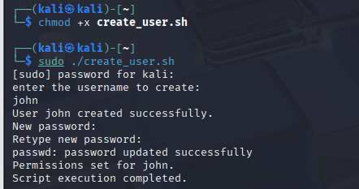
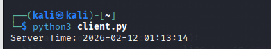

# IT Automation Scripts (Python & Bash)

Scripts that automate everyday system administration tasks on **Windows** and **Linux**, plus a simple **TCP client/server** written with Python sockets.

> University coursework: *Computing Infrastructure*, BSc (Hons) Computing at Regent College London.

## What's inside

| Folder | Script | What it does |
|---|---|---|
| `windows/` | `create_user.py` | Creates a local Windows user (`net user`) and a private folder with permissions set via `icacls`. Run as Administrator. |
| `windows/` | `backup.py` | Creates a timestamped ZIP backup of a folder using only the standard library. |
| `linux/` | `create_user.sh` | Creates a Linux user (`useradd`), sets a password, creates a shared folder and restricts it with `chown` / `chmod 700`. |
| `linux/` | `backup.sh` | Creates a timestamped `.tar.gz` backup of the home directory. |
| `client-server/` | `server.py` / `client.py` | TCP server that sends the current system time to a connecting client. |

## Skills demonstrated

- User and permission management on Windows (`net user`, `icacls`) and Linux (`useradd`, `passwd`, `chown`, `chmod`)
- Backup automation with timestamped archives (`shutil`, `tar`)
- Checking for admin rights and validating input before making changes
- TCP networking: sockets, binding, listening, the three-way handshake, encoding data
- Testing in a Kali Linux VM

## How to run

### Linux
```bash
chmod +x linux/*.sh
sudo ./linux/create_user.sh
./linux/backup.sh
```

### Windows (Command Prompt as Administrator for create_user)
```bat
python windows\create_user.py
python windows\backup.py
```

### Client/server (two terminals)
```bash
python3 client-server/server.py   # terminal 1, start first
python3 client-server/client.py   # terminal 2
```

## Screenshots

| User created (Linux) | Folder permissions | Backup | Client/server |
|---|---|---|---|
|  |  |  |  |

## Possible improvements

- Log every action to a file for auditing
- Keep only the last N backups (rotation) and schedule them with cron / Task Scheduler
- Let the server handle several clients using threads

## Author

**Gabriel Malini Rodrigues** · [LinkedIn](https://www.linkedin.com/in/gabriel-malini)
